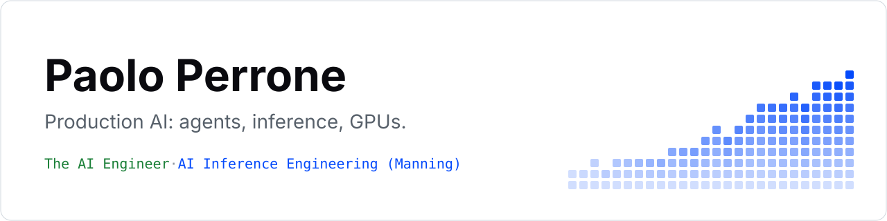

<a href="https://github.com/paolo-perrone">
<picture>
  <source media="(prefers-color-scheme: dark)" srcset="assets/banner-dark.svg">
  
</picture>
</a>

I write [The AI Engineer](https://theaiengineer.substack.com/), twice-weekly breakdowns of agents, inference and GPUs, read by 35K+ engineers at NVIDIA, Anthropic and OpenAI. I'm also writing *AI Inference Engineering* for Manning.

I spent 8 years as an ML engineer, most of them building Prediktiva, the first data science agency in Latin America, which I founded and which was acquired in 2024. Before ML, I started out in investment banking.

**Start here:** [Latest Issues](#-latest-from-the-ai-engineer) · [The Book](#-the-book-ai-inference-engineering) · [Work With Me](#-work-with-me) · [Open Source](#️-open-source)

 

## 📖 Latest From The AI Engineer

<!-- BLOG-POST-LIST:START -->
- [What is a Transformer?](https://theaiengineer.substack.com/p/what-is-a-transformer)
- [Continuous Batching vs Speculative Decoding](https://theaiengineer.substack.com/p/continuous-batching-vs-speculative)
- [How an AI Bug Hunter Works](https://theaiengineer.substack.com/p/how-an-ai-bug-hunter-works)
- [What is a GPU Kernel?](https://theaiengineer.substack.com/p/what-is-a-gpu-kernel)
- [A Crash Course in Verifying Agent Code](https://theaiengineer.substack.com/p/a-crash-course-in-verifying-agent)
<!-- BLOG-POST-LIST:END -->

 

## 📕 The Book: AI Inference Engineering

I'm writing it for Manning, subtitled *Serving LLMs in Production*: how a request becomes tokens, and what each layer costs, from GPUs and kernels to batching, KV cache and speculative decoding. The companion code is public in [ai-inference-engineering](https://github.com/paolo-perrone/ai-inference-engineering) while I write.

 

## 🤝 Work With Me

If you build for AI engineers, I can put your product in front of 1M+ of them, in content they actually read. NVIDIA has sponsored my posts for 2 years, and 100+ AI companies have done the same, including the teams below.

| | | | | | |
| :---: | :---: | :---: | :---: | :---: | :---: |
| <picture><source media="(prefers-color-scheme: dark)" srcset="assets/logos/nvidia-dark.svg"></picture> NVIDIA | <picture><source media="(prefers-color-scheme: dark)" srcset="assets/logos/google-dark.svg"></picture> Google | <picture><source media="(prefers-color-scheme: dark)" srcset="assets/logos/microsoft-dark.svg"></picture> Microsoft | <picture><source media="(prefers-color-scheme: dark)" srcset="assets/logos/aws-dark.svg"></picture> AWS | <picture><source media="(prefers-color-scheme: dark)" srcset="assets/logos/vercel-dark.svg"></picture> Vercel | <picture><source media="(prefers-color-scheme: dark)" srcset="assets/logos/atlassian-dark.svg"></picture> Atlassian |
| <picture><source media="(prefers-color-scheme: dark)" srcset="assets/logos/mongodb-dark.svg"></picture> MongoDB | <picture><source media="(prefers-color-scheme: dark)" srcset="assets/logos/redis-dark.svg"></picture> Redis | <picture><source media="(prefers-color-scheme: dark)" srcset="assets/logos/langchain-dark.svg"></picture> LangChain | <picture><source media="(prefers-color-scheme: dark)" srcset="assets/logos/sentry-dark.svg"></picture> Sentry | <picture><source media="(prefers-color-scheme: dark)" srcset="assets/logos/coderabbit-dark.svg"></picture> CodeRabbit | <picture><source media="(prefers-color-scheme: dark)" srcset="assets/logos/airtable-dark.svg"></picture> Airtable |

**[Partner with me](https://tally.so/r/laadRX)** &nbsp;·&nbsp; [Portfolio](https://paoloperrone.com)

 

## 🛠️ Open Source

Each repo is the companion to an issue of The AI Engineer: one failure from production, made small enough to run in a minute.

| Repository | What it shows you |
| :--- | :--- |
| **[agent-harness](https://github.com/paolo-perrone/agent-harness)** | The 5 layers of an agent harness, each with the failure it prevents. Runs with no API key. |
| **[agent-crash-recovery](https://github.com/paolo-perrone/agent-crash-recovery)** | The same agent on LangGraph, Inngest, DBOS and Temporal. Kill it mid-run and see which steps you pay for twice. |
| **[self-host-boundaries](https://github.com/paolo-perrone/self-host-boundaries)** | A self-hosted LLM stack broken on purpose, one failure per boundary, to test your pre-flight checks. |
| **[gpt2-by-hand](https://github.com/paolo-perrone/gpt2-by-hand)** | GPT-2 small in plain numpy, block by block, matching Hugging Face to within 0.0007. |
| **[boxfit](https://github.com/paolo-perrone/boxfit)** | Whether your model fits an RTX 5090, a Mac Studio or a DGX Spark, and how fast it runs. |
| **[spec-window](https://github.com/paolo-perrone/spec-window)** | The batch size where speculative decoding stops paying on your vLLM server, from one /metrics scrape. |

**Smaller tools:** [cuda-stack-check](https://github.com/paolo-perrone/cuda-stack-check) (the layer breaking your PyTorch CUDA stack) · [kernel-trace-check](https://github.com/paolo-perrone/kernel-trace-check) (the one lever your step time points at) · [chunk-position-check](https://github.com/paolo-perrone/chunk-position-check) (the prompt slot your model reads worst) · [transformer-xray](https://github.com/paolo-perrone/transformer-xray) (context or training: where an answer came from)

 

## ⭐ Keep It Free

Everything here is free to read and run. Three ways to keep it that way:

- **Star** the repos you use. It's how other engineers find them.
- **Share** a tool or an issue with your team.
- **Sponsor** the work through the Sponsor button on any of my repos, or [partner with me](https://tally.so/r/laadRX) on a piece.
